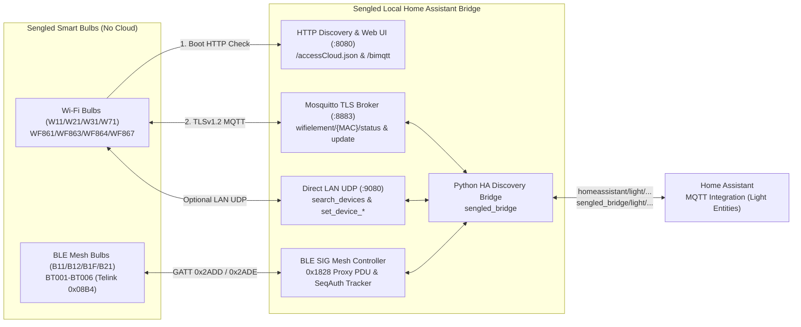

# Sengled Local Home Assistant Bridge (No Cloud / No Zigbee)

A 100% local, cloud-free software bridge and provisioning toolkit that integrates **Sengled Wi-Fi** and **Sengled Bluetooth (BLE SIG Mesh)** smart bulbs into **Home Assistant** as native `light` entities via MQTT Discovery.

---

## Highlights

- **Comprehensive Model & FCC ID Catalog (`2AGN8-*`)**: Built-in fingerprinting and capability database covering **12 FCC-certified Sengled radio modules** (`WF861`, `WF862`, `WF863` ESP8266, `WF864` MXCHIP, `WF866`, `WF867`, `SLMB01`, `BT001`–`BT006` Telink/Phyplus) and **30+ bulb/strip model families** (`W11`, `W12`, `W13`, `W17`, `W1E`, `W1G`, `W21`, `W2G`, `W31`, `W41`, `W71`, `B11`, `B12`, `B16`, `B1C`, `B1F`, `B1G`, `B1K`, `B21`, `S21`).
- **Sengled Wi-Fi Local Takeover (Stock Firmware)**:
  - **Provisioning CLI & Web UI**: Pairs reset Wi-Fi bulbs (`192.168.8.1:9080` UDP, RC4 `KEY_STR` encryption) onto your 2.4 GHz LAN and overrides `appServerDomain` (`/life2/device/accessCloud.json`) and `jbalancerDomain` (`/jbalancer/new/bimqtt`) to point to your local server.
  - **Local Control Server**: Embedded HTTP config responder (preserving Sengled's firmware typo `"protocal": "mqtt"`) + auto-generated self-signed TLS certificates for port `8883` Mosquitto + direct LAN UDP (`9080`) discovery/control.
  - **ESP8266 (`2AGN8-WF863`) Dual-Path Support**: Works out of the box with stock firmware or direct ESPHome/Tasmota flashing (template included at [`esphome/sengled-wf863-esp8266.yaml`](esphome/sengled-wf863-esp8266.yaml)).
- **Sengled Bluetooth (BLE SIG Mesh) Controller**:
  - Supports Telink (`0x08B4`) & Phyplus Bluetooth SIG Mesh bulbs (`0x1827` PB-GATT / `0x1828` Mesh Proxy `0x2ADD`/`0x2ADE`).
  - Solves the two notorious Sengled BLE Mesh pitfalls: automatic `ProxyConfigSetFilterType(EXCLUSION_LIST_FILTER)` initialization and disk-persisted `mesh_seq_floor` sequence tracking (`SeqAuth` anti-replay protection).
  - Includes an ESPHome Bluetooth Proxy template ([`esphome/sengled-ble-proxy.yaml`](esphome/sengled-ble-proxy.yaml)).
- **Native Home Assistant MQTT Discovery**: Automatically publishes `homeassistant/light/sengled_{mac}/config` with full On/Off, Brightness (`0`–`255`), Color Temperature (`2000K`–`6500K`), RGB color, transition (`gradientTime`), effects (`audio_sync`, `video_sync`, `game_sync`), and availability tracking.

---

## Architecture



---

## Quick Start

### Option 1: Docker Compose

1. Set your host's LAN IP in `.env` or environment and launch the stack:
   ```bash
   ADVERTISE_IP=192.168.1.100 docker compose up -d --build
   ```
2. Open the Web UI at `http://192.168.1.100:8080/` to look up models/FCC IDs, monitor endpoint hits, or provision reset Wi-Fi bulbs.

### Option 2: Home Assistant Add-on

1. In Home Assistant, navigate to **Settings -> Add-ons -> Add-on Store -> Repositories (⋮)** and add:
   `https://github.com/prerakchavda/sengled-local-ha-bridge`
2. Install **Sengled Local Home Assistant Bridge**, set `advertise_ip` to your Home Assistant LAN IP, and click **Start**.

### Option 3: Python CLI

```bash
pip install -e .

# 1. Fingerprint any Sengled model or FCC ID (or list all 30+ models)
sengled-bridge models
sengled-bridge models -q 2AGN8-WF863
sengled-bridge models -q B11-N1E

# 2. Generate self-signed TLS certificates for port 8883 Mosquitto
sengled-bridge certs --dir ./certs --ip 192.168.1.100

# 3. Provision a factory-reset Wi-Fi bulb (connected to Sengled_Wi-Fi Bulb_XXXX AP)
sengled-bridge provision \
  --ssid "MyHome24GHz" \
  --password "MyWiFiPassword" \
  --server-ip 192.168.1.100 \
  --http-port 8080

# 4. Discover or control Wi-Fi bulbs directly over LAN UDP port 9080
sengled-bridge udp --discover
sengled-bridge udp --ip 192.168.1.145 --on
sengled-bridge udp --ip 192.168.1.145 --color 255 64 0

# 5. Scan and fingerprint nearby Sengled BLE bulbs
sengled-bridge ble-scan --timeout 8

# 6. Run the bridge daemon
sengled-bridge serve --advertise-ip 192.168.1.100 --http-port 8080 --mqtt-host 127.0.0.1
```

---

## Documentation

- [**Supported Models & FCC ID Catalog (`2AGN8-*`)**](docs/MODELS_AND_FCC_IDS.md)
- [**Wi-Fi & BLE Protocol Reverse Engineering Reference**](docs/PROTOCOL_REVERSE_ENGINEERING.md)
- [**Bulb Reset, Onboarding & Pi-hole/AdGuard DNS Hijack Guide**](docs/ONBOARDING_AND_DNS.md)

---

## Running Tests

```bash
pytest -v
```
