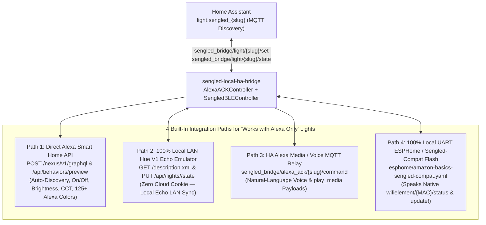

# Amazon Basics & Sengled "Works with Alexa Only" (ACK / BLE) & Matter Integration Guide

This guide covers every way to identify and integrate **Amazon "Works with Alexa Only"** smart lights (both **Amazon Basics Alexa Connect Kit / ACK** Wi-Fi bulbs/switches and **Sengled "Works with Alexa Only" Bluetooth Mesh** bulbs) as well as **Matter-over-Wi-Fi** bulbs into **`sengled-local-ha-bridge`** and **Home Assistant**.

---

## 1. Quick Identification: "Works with Alexa Only" (ACK / BLE) vs. Matter

| Model / ASIN Examples | Printed Logo & Barcode | FCC ID / Internal Module | Built-in `sengled-local-ha-bridge` Support |
| :--- | :--- | :--- | :--- |
| **Amazon Basics Multicolor A19 / A60 / BR30** (`13aSB-A800ST-Q1T`, `13aSB-A806ST-Q1T_EU`, `13aSB-A806ST-Q1T_JP`, `B0C332SMK8`, `B0CG5VDC8P`, `B0CYPQM746`, `B0C333MTB5`) | **"Works with Alexa Only"** + 2D DataMatrix/QR FFS barcode (DSN `G0...`) | `2AC7Z-ESP32PICOV30` (`ESP32-PICO-V3-ZERO`, ESP-IDF v4.3.2 ACK) | **4 Built-in Paths**: Direct Alexa GraphQL/Behaviors Bridge, Local Hue V1 Echo Emulator, HA Alexa MQTT Relay, or UART ESPHome / Sengled-Protocol Flash |
| **Amazon Basics Soft White 2700K A19 / BR30** (`13aSB-A806ST-Q1R_NA`, `13aSB-A806ST-Q1R_EU`, `B0C3349GNR`) | **"Works with Alexa Only"** + 2D DataMatrix/QR FFS barcode | `2AC7Z-ESP32PICOV30` (`ESP32-PICO-V3-ZERO` ACK) | **4 Built-in Paths** (On/Off + Brightness `0`–`255`) |
| **Amazon Basics Switch / Dimmer / Plug** (`WS30-01`, `WP52-2`, `B0CW5D561J`, `B0CPY295K7`, `B0CRKTC31J`, `B0CMXR538P`, `B0CMXRGBNH`) | **"Works with Alexa Only"** + 2D DataMatrix/QR FFS barcode | `2AC7Z-ESP32PICOV30` (`ESP32-PICO-V3-ZERO` + optional `AT32F415` MCU) | Direct Alexa GraphQL Bridge, Local Hue V1 Echo Emulator, HA Alexa MQTT Relay, or UART Flash |
| **Sengled "Works with Alexa Only" BLE Mesh Bulbs** (`B11-N11`, `B11-N12`, `B11-N13`, `B11-N14`, `B11-N1E`, `B12-N11`, `B12-N1E`, `B1F-N5E`, `B21-N1E`) | **"Works with Alexa Only" / "Auto Pairing with Alexa"** + FFS 2D barcode | `2AGN8-BT001`..`BT006` (Telink `TLSR825x` / Phyplus `PHY6222QC`) | **Direct Local BLE SIG Mesh Proxy (`0x1828`)** (`--ble-bulb`) **OR** Echo-Paired Alexa GraphQL Bridge (`--ack-light` / `--alexa-cookie`) |
| **Amazon Basics & Sengled Matter Bulbs / Plugs** (`AB-MATTER-A19`, `AB-MATTER-PLUG`, `W41-N15AW`) | **Matter Logo** + `MT:...` QR code + 11-digit numeric code (`XXXX-XXX-XXXX`) | `2AC7Z-ESP32PICOV30` / `2AGN8-WF866` | **100% Local Matter-over-Wi-Fi** (`sengled-bridge matter`) |

---

## 2. All 4 Ways to Make "Works with Alexa Only" Lights Work with `sengled-local-ha-bridge`

Because non-Matter Amazon Basics "Works with Alexa Only" bulbs run Amazon's **Alexa Connect Kit (ACK)** on an **Espressif `ESP32-PICO-V3-ZERO`** (`FCC ID: 2AC7Z-ESP32PICOV30`) with factory-provisioned mTLS client certificates in encrypted NVS flash, `sengled-local-ha-bridge` includes **four built-in integration engines** (`sengled_bridge/alexa_ack_bridge.py`) so you can control them as native Home Assistant `light.sengled_*` entities with or without opening the bulb:



---

### Path 1: Direct Alexa Smart Home GraphQL & Behaviors Bridge (Zero Hardware Mod)

When you pass your Amazon Alexa session cookie (`--alexa-cookie`) or register an ACK light (`--ack-light`), `sengled-local-ha-bridge` communicates directly with Amazon's `/nexus/v1/graphql` and `/api/behaviors/preview` (`Alexa.SmartHome.Batch`) endpoints:
- **Auto-Discovery**: Queries `POST https://alexa.amazon.com/nexus/v1/graphql` (`Endpoints`), discovers all "Works with Alexa Only" lights on your account (`13aSB-A800ST-Q1T`, `13aSB-A806ST-Q1R`, Echo-paired Sengled `B11-N1E`, etc.), and publishes `homeassistant/light/sengled_{slug}/config` for each light.
- **Full RGB Color, Color Temperature, Brightness & On/Off**:
  - Maps any RGB `(r, g, b)` color picked in Home Assistant to the closest official `Alexa.ColorController` `colorName` across 125+ Alexa colors (`crimson`, `salmon`, `gold`, `turquoise`, `dodger_blue`, `deep_pink`, etc.).
  - Maps Kelvin (`2000K`–`7000K`) to both `colorTemperatureInKelvin` (`setEndpointFeatures`) and `colorTemperatureName` (`warm_white` 2200K, `soft_white` 2700K, `white` 4000K, `daylight_white` 5500K, `cool_white` 7000K).

```bash
# Parse an Amazon Basics FFS 2D barcode, DSN, or model string
sengled-bridge alexa-ack --barcode "DSN:G09123456789ABCD;MODEL:13aSB-A800ST-Q1T"

# Auto-discover all "Works with Alexa Only" lights from your Alexa account
sengled-bridge alexa-ack --discover --cookie "session-id=...; ubid-main=...; at-main=...; csrf=..."

# Test controlling an Alexa-only light (outputs GraphQL, Behaviors Batch, Phoenix & Voice payloads)
sengled-bridge alexa-ack --id "G09123456789ABCD" --name "Bedroom Light" --color 255 20 145 --brightness 200

# Run the bridge daemon with Alexa auto-discovery and/or explicit ACK lights
sengled-bridge serve \
  --advertise-ip 192.168.1.100 \
  --mqtt-host 127.0.0.1 \
  --ack-light "G09123456789ABCD,13ASB-A800ST-Q1T,Bedroom Light" \
  --alexa-cookie "session-id=...; at-main=...; csrf=..."
```

---

### Path 2: Built-in 100% Local LAN Echo / Philips Hue V1 Emulator (No Cloud Cookie Needed)

Every Amazon Echo device has a built-in **local Philips Hue V1 client** on your LAN. `sengled-local-ha-bridge` automatically exposes every registered `--ack-light` on its local HTTP server as a Philips Hue V1 Extended Color Light (`LCT015`):
- `GET http://<BRIDGE_IP>:8080/description.xml` (UPnP Philips Hue Bridge descriptor)
- `POST http://<BRIDGE_IP>:8080/api` (Local Echo pairing endpoint)
- `GET http://<BRIDGE_IP>:8080/api/<username>/lights` (Lists all registered ACK lights with `on`, `bri`, `ct`, `hue`, `sat`)
- `PUT http://<BRIDGE_IP>:8080/api/<username>/lights/<id>/state` (Receives instant local LAN state updates from your Echo and publishes them immediately to Home Assistant MQTT `sengled_bridge/light/{slug}/state`!)

To enable UDP port `1900` SSDP multicast discovery for your Echo:
```bash
sengled-bridge serve --advertise-ip 192.168.1.100 --enable-hue-ssdp --ack-light "G09123456789ABCD,13ASB-A800ST-Q1T,Office Light"
```

---

### Path 3: Home Assistant `alexa_media` / `alexa_devices` MQTT Command Relay (No Cookie in Bridge)

Whenever Home Assistant sends a command to `sengled_bridge/light/{slug}/set` for a registered ACK light, `sengled-local-ha-bridge` automatically publishes a relay message on `sengled_bridge/alexa_ack/{slug}/command` containing:
- `combined_voice_command`: e.g. `"set Bedroom Light to deep pink and set Bedroom Light brightness to 78 percent"`
- `ha_alexa_media_service_call`: Ready-to-execute `media_player.play_media` (`media_content_type: "custom"`) payload.

You can add this single Home Assistant automation to forward all bridge ACK commands through your existing Home Assistant Alexa integration:
```yaml
automation:
  - alias: "Sengled Bridge -> Forward Amazon ACK Light Commands to Alexa"
    trigger:
      - platform: mqtt
        topic: "sengled_bridge/alexa_ack/+/command"
    action:
      - service: media_player.play_media
        target:
          entity_id: media_player.echo_dot
        data:
          media_content_id: "{{ trigger.payload_json.combined_voice_command }}"
          media_content_type: custom
```

---

### Path 4: 100% Local 3.3V UART Flash to Sengled-Protocol Firmware or Native ESPHome

If you want 100% cloud-free, Echo-free local control on an Amazon Basics `13aSB-A800ST-Q1T` or `13aSB-A806ST-Q1R` bulb (`ESP32-PICO-V3-ZERO` / `FCC ID: 2AC7Z-ESP32PICOV30`):
1. **Unplug from mains AC power!** Never connect a USB-to-TTL adapter while connected to 120V/240V AC.
2. Pop off the plastic diffuser dome to access the `ESP32-PICO-V3-ZERO` test pads (`3V3`, `GND`, `TXD0`, `RXD0`, `GPIO0`).
3. Hold `GPIO0` to `GND` while applying `3.3V` from your USB-to-TTL adapter to enter the ESP32 ROM bootloader.
4. Choose either firmware template included in this repository:
   - **[`esphome/amazon-basics-sengled-compat.yaml`](../esphome/amazon-basics-sengled-compat.yaml)**: Causes the Amazon Basics bulb to speak **Sengled's native `wifielement/{MAC}/status` and `wifielement/{MAC}/update` MQTT protocol** directly to `sengled-local-ha-bridge`!
   - **[`esphome/amazon-basics-ack-esp32.yaml`](../esphome/amazon-basics-ack-esp32.yaml)**: Connects directly to Home Assistant's Native ESPHome API (includes pinouts for 5-channel `LEDC PWM`, `BP5758D` I2C, and `SM2235EGH`/`SM2135E` I2C LED drivers).

---

## 3. Sengled "Works with Alexa Only" Bluetooth Mesh Bulbs (`B11-N11`, `B11-N1E`, `B12-*`, `B1F-*`, `B21-*`)

Sengled's Bluetooth Mesh bulbs are marketed on Amazon as *"Smart Bulbs That Work with Alexa Only"*. You can integrate them into `sengled-local-ha-bridge` in **two ways**:
1. **Keep Paired to Your Echo (Zero Reset)**: Use **Path 1 (`--alexa-cookie` / `--ack-light`)** or **Path 3** above—the Echo acts as the Bluetooth Mesh gateway while `sengled-local-ha-bridge` exposes the bulb to Home Assistant via MQTT Discovery.
2. **100% Local Bluetooth SIG Mesh Proxy (`0x1828`, No Echo / No Cloud)**:
   - Factory reset the bulb (5x rapid power toggle) so it advertises `0x1827` (Mesh Provisioning Service) and Telink Manufacturer ID `0x08B4`.
   - Provision into a local Bluetooth SIG Mesh network (No-OOB) and pass `--ble-bulb <MAC>,<MODEL>` to `sengled-bridge serve` (or use `SengledBLEController.execute_proxy_pdus_gatt()` / [`esphome/sengled-ble-proxy.yaml`](../esphome/sengled-ble-proxy.yaml)).

---

## 4. Commissioning Newer Amazon Basics & Sengled Matter Bulbs (`MT:...`)

If your bulb has a **Matter logo** (`MT:...` QR code or 11-digit numeric code):
```bash
# Decode a Matter QR string and generate its 11-digit manual pairing code
sengled-bridge matter --code "MT:Y.K9042C00KA0648G00"
```
Then commission it directly in Home Assistant (**Settings -> Devices & Services -> Matter**) or via Matter Multi-Admin from the Alexa app (**Device Settings -> Other Assistants and Apps -> Add Another**).
