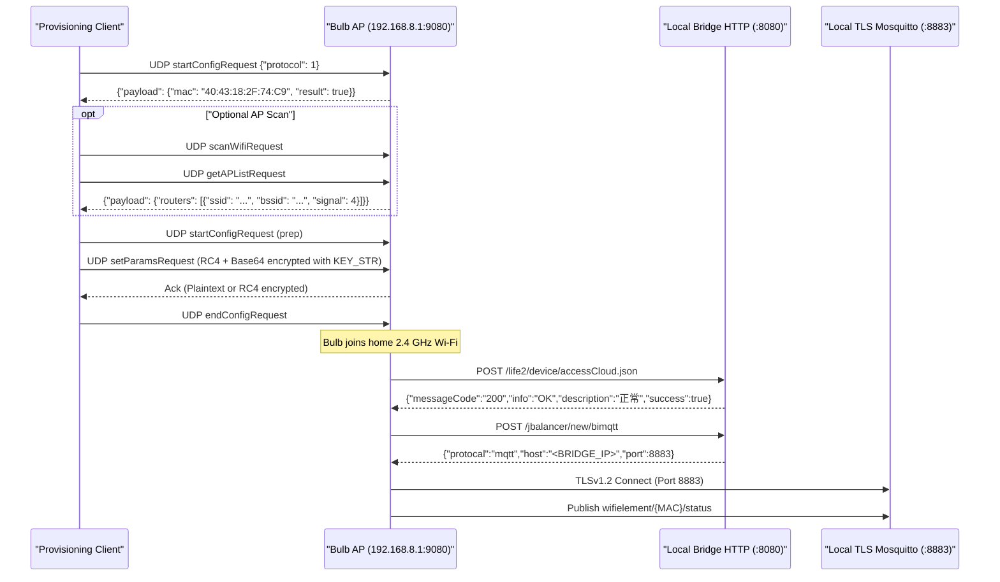

# Sengled Wi-Fi & Bluetooth (BLE) Protocol Reverse Engineering Reference

This document details the verified wire protocols for both **Sengled Wi-Fi** (`WF861`..`WF867`, `SLMB01`) and **Sengled Bluetooth (BLE SIG Mesh)** (`BT001`..`BT006`) smart bulbs.

---

## Part 1: Sengled Wi-Fi Protocol

### 1.1 Wi-Fi AP Onboarding Flow (`192.168.8.1:9080` UDP)

When a Sengled Wi-Fi bulb is factory-reset (5 rapid power cycles), it broadcasts an open 2.4 GHz access point (`Sengled_Wi-Fi Bulb_XXXX`), assigns itself IP `192.168.8.1`, and listens on **UDP port `9080`**.



#### RC4 Encryption (`KEY_STR`)
The `setParamsRequest` UDP packet is encrypted with standard RC4 using the hardcoded ASCII key from the Sengled mobile app and then Base64-encoded:
```text
KEY_STR = "MTlCaWppbmdTaGFuZ2hhaVdpU2VuZ2xlZEZpMjBBQUJBU0U2NA=="
```

#### `setParamsRequest` Cleartext JSON Schema
```json
{
  "name": "setParamsRequest",
  "totalStep": 1,
  "curStep": 1,
  "payload": {
    "userID": "618",
    "appServerDomain": "http://192.168.1.100:8080/life2/device/accessCloud.json",
    "jbalancerDomain": "http://192.168.1.100:8080/jbalancer/new/bimqtt",
    "timeZone": "UTC",
    "routerInfo": {
      "ssid": "MyHome24GHz",
      "password": "MyPassword"
    }
  }
}
```
> [!IMPORTANT]
> If the 2.4 GHz Wi-Fi SSID contains non-ASCII characters, the bulb firmware requires `"ssid": ""` and `"bssid": "AA:BB:CC:DD:EE:FF"` in `routerInfo`.

---

### 1.2 Cloud Discovery HTTP Endpoints

On every boot or reconnect, the bulb sends HTTP requests (`POST`, `PUT`, or `GET`) to its configured `appServerDomain` and `jbalancerDomain`:

1. **`/life2/device/accessCloud.json`** (and alias `/accessCloud.json`):
   ```json
   {
     "messageCode": "200",
     "info": "OK",
     "description": "正常",
     "success": true
   }
   ```
2. **`/jbalancer/new/bimqtt`** (and alias `/bimqtt`):
   ```json
   {
     "protocal": "mqtt",
     "host": "192.168.1.100",
     "port": 8883
   }
   ```
> [!WARNING]
> `"protocal"` (spelled with an `a`) is an actual typo baked into all Sengled Wi-Fi bulb firmware binaries. Returning `"protocol"` will cause the bulb to ignore the broker response.

---

### 1.3 Local TLS MQTT Protocol (Port `8883`)

- **TLS Requirement**: Sengled Wi-Fi bulbs strictly require TLS (`tlsv1.2`) on their MQTT connection (default port `8883`), but they **do not pin or validate the CA certificate chain**—any self-signed server certificate is accepted.
- **MQTT Username Quirk**: While some bulbs connect anonymously, several MXCHIP (`WF861`/`WF864`) firmware versions connect with the literal username `?SDK=C&Version=3.0.1`. Do **not** configure a Mosquitto `password_file` on listener `8883`, and use `pattern` rules in `acl.conf` (`pattern readwrite wifielement/#`) so special characters (`?`, `=`, `&`) in the username never trigger `CONNACK (0, 5)` authorization failures.

#### Topic Namespaces
| Topic | Direction | Purpose |
| :--- | :--- | :--- |
| `wifielement/{MAC}/status` | Bulb -> Broker | State and attribute telemetry JSON array |
| `wifielement/c/status` | Bulb -> Broker | Initial capability announcement (`supportAttributes`) |
| `wifielement/{MAC}/consumption` | Bulb -> Broker | Power consumption telemetry |
| `wifielement/{MAC}/consumptionTime` | Bulb -> Broker | Cumulative operating time |
| `wifielement/{MAC}/update` | Broker -> Bulb | Control commands and OTA firmware triggers |

#### Status Payload Example (`wifielement/40:43:18:2F:74:C9/status`)
```json
[
  {"dn": "40:43:18:2F:74:C9", "type": "brightness", "value": "50", "time": "49"},
  {"dn": "40:43:18:2F:74:C9", "type": "version", "value": "V1.0.0.4", "time": "49"},
  {"dn": "40:43:18:2F:74:C9", "type": "switch", "value": "1", "time": "49"},
  {"dn": "40:43:18:2F:74:C9", "type": "productCode", "value": "wifielement", "time": "49"},
  {"dn": "40:43:18:2F:74:C9", "type": "typeCode", "value": "W31-N11", "time": "49"},
  {"dn": "40:43:18:2F:74:C9", "type": "identifyNO", "value": "ESP8266", "time": "49"},
  {"dn": "40:43:18:2F:74:C9", "type": "ip", "value": "192.168.0.24", "time": "49"},
  {"dn": "40:43:18:2F:74:C9", "type": "deviceRssi", "value": "-55", "time": "49"}
]
```

#### Control Command Schemas (`wifielement/{MAC}/update`)
1. **Power On / Off** (`switch`: `"1"` or `"0"`, optional `gradientTime` in ms):
   ```json
   [{"dn": "80:A0:36:E1:8E:B8", "type": "switch", "value": "1", "time": 1700000000000}]
   ```
2. **Brightness** (`brightness`: `"0"` to `"100"`):
   ```json
   [{"dn": "80:A0:36:E1:8E:B8", "type": "brightness", "value": "75", "time": 1700000000000}]
   ```
3. **RGB Color** (`color`: `"R:G:B"` decimal or `"RRGGBB"` hex):
   ```json
   [{"dn": "80:A0:36:E1:8E:B8", "type": "color", "value": "255:0:128", "time": 1700000000000}]
   ```
4. **Color Temperature** (`colorTemperature`: `"0"` to `"100"` where `0`=2700K and `100`=6500K; **must be bundled with `switch: "1"`**):
   ```json
   [
     {"dn": "80:A0:36:E1:8E:B8", "type": "colorTemperature", "value": "58", "time": 1700000000000},
     {"dn": "80:A0:36:E1:8E:B8", "type": "switch", "value": "1", "time": 1700000000000}
   ]
   ```

---

### 1.4 Direct Local UDP Protocol (Port `9080`)

Even after joining home Wi-Fi, Sengled Wi-Fi bulbs continue listening on **UDP port `9080`** for direct local JSON RPC commands:
- **Broadcast Discovery** (`255.255.255.255:9080`):
  `{"func":"search_devices","param":{}}`
- **Power**:
  `{"func":"set_device_switch","param":{"switch":1}}`
- **Brightness (`0`–`100`)**:
  `{"func":"set_device_brightness","param":{"brightness":50}}`
- **RGB Color (`0`–`255`)**:
  `{"func":"set_device_color","param":{"red":255,"green":0,"blue":0}}`
- **Color Temperature (`0`–`100`)**:
  `{"func":"set_device_colortemp","param":{"colorTemperature":50}}`

---

## Part 2: Sengled Bluetooth (BLE SIG Mesh) Protocol

Sengled Bluetooth bulbs (`B11-N11`, `B11-N12`, `B11-N13`, `B11-N14`, `B11-N1E`, `B12-N11`, `B12-N1E`, `B1F-N5E`, `B1K-N1G`, `B21-N1E` with modules `2AGN8-BT001`..`BT006`) are **standard Bluetooth SIG Mesh nodes** powered by Telink (`TLSR825x`, Manufacturer ID `0x08B4`) or Phyplus (`PHY6222QC`) SoCs.

### 2.1 Why Raw GATT Writes Fail
Unlike simple BLE peripherals (e.g., MagicHome or Triones), Sengled BLE bulbs do **not** expose an unencrypted RGB GATT characteristic. All lighting commands traverse the 5-layer Bluetooth SIG Mesh stack:
1. **Access Layer**: Lighting model opcodes (`GenericOnOffSet` `0x8202`, `LightLightnessSet` `0x824C`, `LightCTLSet` `0x825E`, `LightHSLSet` `0x8276`)
2. **Upper Transport Layer**: Encrypted with 128-bit `AppKey` (AES-CCM)
3. **Lower Transport Layer**: Segmentation & Reassembly (SAR) + Transport MIC
4. **Network Layer**: Encrypted with 128-bit `NetKey` + Privacy Key, carrying 24-bit sequence number `SeqNum`
5. **Mesh Proxy PDU Layer**: Encapsulated in GATT Service `0x1828` (`0x2ADD` Data In, `0x2ADE` Data Out)

### 2.2 GATT Services & Provisioning Flow
1. **Unprovisioned State (`0x1827` — Mesh Provisioning Service)**:
   - After 5x physical switch reset, the bulb advertises UUID `0x1827` (`0x2ADB` Data In, `0x2ADC` Data Out) and Manufacturer ID `0x08B4`.
   - Uses **PB-GATT No-OOB** ECDH key exchange to distribute the 128-bit `NetKey` and assign a Unicast address (e.g. `0x0002`).
2. **Provisioned State (`0x1828` — Mesh Proxy Service)**:
   - Once provisioned, `0x1827` disappears and the bulb advertises `0x1828` (`0x2ADD` Data In, `0x2ADE` Data Out).
   - **Proxy Filter Requirement (`EXCLUSION_LIST_FILTER`)**: On connection to `0x1828`, the bulb's proxy filter defaults to an empty Whitelist (`0x00`), silently dropping all status responses. The controller must immediately send `ProxyConfigSetFilterType(0x01)` (`[0x00, 0x01]`) to destination `0x0000`.
   - **Replay Protection (`SeqAuth` / `mesh_seq_floor`)**: Bluetooth Mesh nodes discard any packet with `SeqNum <= last_seen_seq`. Our [`MeshSequenceTracker`](../sengled_bridge/ble_controller.py) persists `mesh_seq_floor` to disk and increments by a safety stride on startup so service restarts never lose control of the bulb.
